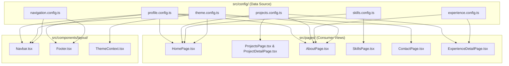

# Portfolio Maintenance & Customization Guide

Welcome to the definitive self-service maintenance manual for this portfolio. This codebase was engineered with a **strictly decoupled, configuration-driven architecture**. Almost all content—personal information, projects, experiences, education, skills, social links, theme colors, and assets—can be managed directly from TypeScript configuration files located in [`src/config/`](src/config/), without touching complex React logic or JSX styling.

Use this document as your single reference for adding new projects, updating your resume, managing your career timeline, and tweaking visual themes.

---

## Table of Contents

1. [Architecture & Data Flow](#1-architecture--data-flow)
2. [Quick Reference: Where Do I Change What?](#2-quick-reference-where-do-i-change-what)
3. [Personal Information & Hero Section](#3-personal-information--hero-section)
4. [Skills & Floating Technology Logos](#4-skills--floating-technology-logos)
5. [Projects Management](#5-projects-management)
6. [Assigning Projects to Work Experiences (Crucial)](#6-assigning-projects-to-work-experiences-crucial)
7. [Work Experience & Career Promotions](#7-work-experience--career-promotions)
8. [Education & Certifications](#8-education--certifications)
9. [About Page Breakdown](#9-about-page-breakdown)
10. [Contact Page & Email Delivery](#10-contact-page--email-delivery)
11. [Navigation, Social Links & Downloadable CV](#11-navigation-social-links--downloadable-cv)
12. [Images, Icons, and Asset Management](#12-images-icons-and-asset-management)
13. [Theme, Colors & Global Visual Settings](#13-theme-colors--global-visual-settings)
14. [Development, Validation & Troubleshooting](#14-development-validation--troubleshooting)
15. [Catalog of Hardcoded UI Elements](#15-catalog-of-hardcoded-ui-elements)

---

## 1. Architecture & Data Flow

### Directory Structure

```
mu-3mar.github.io/
├── public/                               # Static assets served at the root URL
│   ├── favicon.ico, favicon.svg          # Multi-resolution browser tab icons
│   ├── favicon-32.png, favicon-48.png    # High-density tab icons
│   ├── icon-192.png, icon-512.png        # PWA icons
│   ├── Muhammad_Ammar_...Resume.pdf      # Downloadable CV / Resume
│   └── images/
│       ├── profile_dark_theme.png        # Dark mode portrait avatar
│       ├── profile_light_theme.png       # Light mode portrait avatar
│       ├── logo-dark.png, logo-light.png # Navbar logos (light & dark)
│       └── projects/                     # High-res 16:9 project cover images
├── src/
│   ├── config/                           # *** SINGLE SOURCE OF TRUTH FOR DATA ***
│   │   ├── profile.config.ts             # Name, headline, bio, contact, resume, socials
│   │   ├── projects.config.ts            # Projects catalog, tech, problem/solution, metrics
│   │   ├── experience.config.ts          # Work history, roles, promotions, education, courses
│   │   ├── skills.config.ts              # Skill groups, floating tech logos, coordinates
│   │   ├── navigation.config.ts          # Navbar links, footer copyright settings
│   │   ├── theme.config.ts               # Brand colors (gold/accent), theme tokens, assets
│   │   └── index.ts                      # Central config export barrel
│   ├── components/
│   │   ├── common/                       # ProjectCard, ProjectImage, SectionHeader, SocialLinks
│   │   └── layout/                       # Navbar, Footer, ThemeToggle, Layout wrapper
│   ├── context/
│   │   └── ThemeContext.tsx              # Dark/light mode state & dynamic CSS variable injector
│   ├── pages/                            # Route views: Home, Projects, About, Skills, Contact
│   └── styles/
│       ├── theme.css                     # Base CSS variables & color transitions
│       └── main.css                      # Master responsive stylesheet
├── api/
│   └── contact.js                        # Production Vercel serverless function (Resend email)
├── server/
│   └── index.js                          # Local development API server (Node Express)
└── scripts/
    └── generate_logos.py                 # Automated script for generating edge-to-edge favicons
```

### Data Flow Diagram



---

## 2. Quick Reference: Where Do I Change What?

| If you want to change... | File to edit | Key property or section |
| :--- | :--- | :--- |
| **Full Name or Title** | `src/config/profile.config.ts` | `profileConfig.name`, `profileConfig.title` |
| **Hero headline & subtitle** | `src/config/profile.config.ts` | `profileConfig.heroSubtitle`, `profileConfig.heroSummary` |
| **About Me biography** | `src/config/profile.config.ts` | `profileConfig.aboutSummary` |
| **Avatar / Profile pictures** | `src/config/theme.config.ts` | `themeConfig.branding.avatarDarkUrl`, `avatarLightUrl` |
| **Add / Edit a Project** | `src/config/projects.config.ts` | `projects` array |
| **Project cover images** | `public/images/projects/` | File: `project-[slug]-cover.png` |
| **Add / Edit Work Experience** | `src/config/experience.config.ts` | `experience` array |
| **Add / Edit Promotions in Company** | `src/config/experience.config.ts` | `experience[i].roles` array |
| **Assign Project to an Experience** | `src/config/projects.config.ts` | `companySlug: '<experience-slug>'` |
| **Add / Edit Education or Degree** | `src/config/experience.config.ts` | `education` array |
| **Add / Edit Courses & Certifications** | `src/config/experience.config.ts` | `courses` array |
| **Floating tech stack icons** | `src/config/skills.config.ts` | `floatingTechnologyLogos` array |
| **Email, Phone, or Social links** | `src/config/profile.config.ts` | `profileConfig.contact`, `profileConfig.socials` |
| **Downloadable Resume (CV)** | `public/` & `profile.config.ts` | Place PDF in `public/`, set `profileConfig.resume.url` |
| **Brand Gold or Theme Colors** | `src/config/theme.config.ts` | `themeConfig.colors.dark` and `colors.light` |
| **Navigation menu links** | `src/config/navigation.config.ts` | `navItems` array |

---

## 3. Personal Information & Hero Section

### Exact File: `src/config/profile.config.ts`

This file owns your personal identity, professional headline, biography, contact details, social profiles, and resume metadata.

```ts
export interface ProfileConfig {
  name: string
  firstName: string
  initials: string
  title: string
  role: string
  headline: {
    lineOne: string
    highlightWord: string
    lineTwo: string
  }
  heroSubtitle: string
  heroSummary: string
  aboutSummary: string
  aboutPillars: string[]
  technologiesSummary: string
  contact: {
    email: string
    phone: string
    phoneHref: string
    heading: string
    subheading: string
  }
  socials: {
    github: string
    linkedin: string
    kaggle: string
    twitter?: string
  }
  resume: {
    url: string
    downloadFilename: string
    label: string
  }
}
```

### If you want to change your name
1. Open `src/config/profile.config.ts`.
2. Update:
   ```ts
   name: 'Muhammad Ammar',
   firstName: 'Muhammad',
   initials: 'MA',
   ```
3. **Where it appears:** The Navbar monogram fallback, Hero heading on the Home page, About page header, Footer copyright, and `<title>` tag.

### If you want to change your professional title
1. Open `src/config/profile.config.ts`.
2. Update:
   ```ts
   title: 'Senior Machine Learning Engineer',
   role: 'Senior Machine Learning Engineer',
   ```
3. **Where it appears:** Subtitle directly below your name on the Home page hero section.

### If you want to update the Hero banner headline and summary
1. Open `src/config/profile.config.ts`.
2. Edit:
   ```ts
   heroSubtitle: 'From Data to Deployed ML Models',
   heroSummary:
     'I build machine learning pipelines for classification, regression, and computer vision — from data preparation and feature engineering to model evaluation and FastAPI deployment.',
   ```
3. **Where it appears:** Rendered as the secondary headline (`.hero-headline`) and description paragraph (`.hero-summary`) on the Home page.

### If you want to update your About Me text
1. Open `src/config/profile.config.ts`.
2. Edit `aboutSummary`:
   ```ts
   aboutSummary:
     'Machine Learning Engineer with hands-on experience building end-to-end machine learning solutions...',
   ```
3. **Where it appears:** In the spotlight paragraph at the top of `/about` next to your portrait.

---

## 4. Skills & Floating Technology Logos

The portfolio features an interactive **Floating Technology Logos** field on both the Home page and the dedicated Skills page (`/skills`).

### Exact Files:
- Data & Coordinates: [`src/config/skills.config.ts`](src/config/skills.config.ts)
- Icon Component Registry: [`src/components/common/FloatingLogoField.tsx`](src/components/common/FloatingLogoField.tsx)

### How the Floating Logo System Works
Each floating logo entry defines:
- `name`: Display name and accessibility label.
- `iconKey`: Identifier mapped to an SVG icon component in `FloatingLogoField.tsx`.
- `home`: `[leftPercent, topPercent, sizePx]` coordinates on the Home page.
- `skills`: `[leftPercent, topPercent, sizePx]` coordinates on the Skills page.

```ts
export interface FloatingTechnology {
  name: string
  iconKey: string
  home: [number, number, number]   // [X %, Y %, Size px]
  skills: [number, number, number] // [X %, Y %, Size px]
}
```

### If you want to add a new floating skill icon (e.g. Scrapy)

#### Step 1: Verify the icon in `@icons-pack/react-simple-icons`
The project uses the **Simple Icons** library (`@icons-pack/react-simple-icons`). All brand names are prefixed with `Si` in CamelCase (e.g., `SiPython`, `SiDocker`, `SiPytorch`, `SiScikitlearn`, `SiFastapi`).

#### Step 2: Register the icon in `src/components/common/FloatingLogoField.tsx`
1. Open `src/components/common/FloatingLogoField.tsx`.
2. Import the icon from `@icons-pack/react-simple-icons`:
   ```tsx
   import {
     SiPython,
     SiScrapy, // <-- Add your new import
     // ...
   } from '@icons-pack/react-simple-icons'
   ```
3. Add the mapping to `iconRegistry`:
   ```tsx
   const iconRegistry: Record<string, React.ComponentType<{ 'aria-hidden'?: boolean }>> = {
     Python: SiPython,
     Scrapy: SiScrapy, // <-- Add mapping here
     // ...
   }
   ```

#### Step 3: Add the entry to `src/config/skills.config.ts`
1. Open `src/config/skills.config.ts`.
2. Append to `floatingTechnologyLogos`:
   ```ts
   { name: 'Scrapy', iconKey: 'Scrapy', home: [50, 20, 40], skills: [50, 20, 44] },
   ```
3. **Important Rules:**
   - Keep `leftPercent` and `topPercent` between `10%` and `88%` so icons don't overflow the container.
   - Recommended sizes: `34` to `54` pixels.
   - The animation drift is applied automatically.

---

## 5. Projects Management

### Exact File: `src/config/projects.config.ts`

This file is the single catalog of all technical projects across the entire website. Adding a project here automatically:
1. Creates a responsive project card in `/projects`.
2. Creates a card on the Home page (if `featured: true`).
3. Creates a dedicated detail page at `/projects/:slug`.
4. Adds the project category to the filter chips row on `/projects`.
5. Links the project to related projects by category.
6. Connects the project to an experience if `companySlug` is provided.

### Complete TypeScript Schema

```ts
export interface Project {
  /** Unique URL path segment, e.g. 'my-cool-project' -> /projects/my-cool-project */
  slug: string
  /** Human-readable title displayed on cards and headers */
  title: string
  /** Primary category. Preferred: 'Machine Learning' | 'Deep Learning' | 'NLP' | 'Computer Vision' */
  category: string
  /** Internal type category */
  type: string
  /** Context subtitle, e.g. 'Internship · Cellula Technology' or 'Self-Practice' */
  context?: string
  /** Company name if executed during employment/internship */
  company?: string
  /** Matches slug in experience.config.ts to connect project to an experience */
  companySlug?: string
  /** If true, appears in the "Featured projects" section on the Homepage */
  featured: boolean
  /** Concise 1-2 sentence overview for cards and summary blocks */
  description: string
  /** The business or technical challenge addressed */
  problem: string
  /** The architecture or machine learning methodology used */
  solution: string
  /** Your specific engineering role and accomplishments */
  contribution?: string
  /** List of technologies rendered as badges (first 4 shown on cards) */
  tech: string[]
  /** URL to the public GitHub repository */
  githubUrl: string
  /** Optional URL to a deployed demo or live application */
  demoUrl?: string
  /** Path to 16:9 cover image in /public/images/projects/ */
  image: string
  /** Optional array of implementation bullet points displayed on the detail page */
  implementationPoints?: string[]
}
```

### Complete Copy-Pasteable Template

```ts
{
  slug: 'new-nlp-sentiment-pipeline',
  title: 'Real-Time Customer Sentiment Pipeline',
  category: 'NLP',
  type: 'NLP',
  context: 'Self-Practice',
  featured: true,
  description:
    'Built an end-to-end sentiment classification pipeline using fine-tuned transformer models and FastAPI for real-time customer feedback analysis.',
  problem:
    'Customer support teams required an automated, low-latency triage system to identify negative user reviews before escalation.',
  solution:
    'Fine-tuned a lightweight RoBERTa model with quantization for fast inference, served via an asynchronous FastAPI REST endpoint.',
  contribution:
    'Curated and cleaned the training dataset, performed hyperparameter tuning, benchmarked latency, and packaged the service into a Docker container.',
  tech: ['Python', 'PyTorch', 'Hugging Face', 'FastAPI', 'Docker'],
  githubUrl: 'https://github.com/mu-3mar/new-nlp-sentiment-pipeline',
  demoUrl: 'https://demo.example.com', // Optional: omit if no live demo
  image: '/images/projects/project-new-nlp-sentiment-cover.png',
  implementationPoints: [
    'Cleaned and tokenized 100K+ multilingual customer reviews with automated label smoothing.',
    'Fine-tuned transformer models achieving an 0.93 macro F1-score across 5 sentiment classes.',
    'Reduced inference latency from 120ms to 24ms per request using dynamic ONNX quantization.',
    'Exposed a documented Swagger UI endpoint with health checks and Prometheus metrics.',
  ],
},
```

### How Project Categories & Filters Work
In `src/pages/ProjectsPage.tsx`:
- The core preferred order is: `['Machine Learning', 'Deep Learning', 'NLP', 'Computer Vision']`.
- **Dynamic Category Detection:** If you add a project with a new category (such as `'Generative AI'`), the page automatically generates a new filter chip for `'Generative AI'` without modifying any React code.
- Selecting any chip filters the list instantly without full page reloads.

---

## 6. Assigning Projects to Work Experiences (Crucial)

The portfolio implements a clean **Single Source of Truth** pattern between projects and experiences. You never need to duplicate project summaries or tech stacks in multiple files.

### The Connection Mechanism

The relationship is established using the **`companySlug`** property:

```
src/config/projects.config.ts                      src/config/experience.config.ts
┌──────────────────────────────────────┐          ┌──────────────────────────────────────┐
│ {                                    │          │ {                                    │
│   title: 'Hotel Booking Prediction', │          │   company: 'Cellula Technology',     │
│   slug: 'hotel-booking-prediction',  │          │   role: 'Machine Learning Intern',   │
│   company: 'Cellula Technology',     │          │   period: 'Oct 2025 – Dec 2025',     │
│   companySlug: 'cellula-technology'  │ ◄──────► │   slug: 'cellula-technology',        │
│ }                                    │          │ }                                    │
└──────────────────────────────────────┘          └──────────────────────────────────────┘
```

### How the UI Uses This Relationship:
1. **On the About Page (`/about`):**
   The badge in the Experience card calculates the real project count dynamically:
   ```ts
   projectCount = projects.filter(p => p.companySlug === job.slug).length
   ```
   If 2 projects have `companySlug: 'cellula-technology'`, the badge displays **`2 Projects →`**.
2. **On the Experience Detail Page (`/experience/:slug`):**
   When a visitor clicks the company card, the page automatically queries `projects.config.ts` for all projects where `p.companySlug === entry.slug` and renders them as standard project cards.
3. **On the Project Detail Page (`/projects/:slug`):**
   If `company` and `companySlug` exist, the header displays:
   `Developed during internship at Cellula Technology →`, linking back to `/experience/cellula-technology`.

### Step-by-Step: Adding a New Project to an Existing Experience
1. Open `src/config/projects.config.ts`.
2. Add your project object to `projects`.
3. Set:
   ```ts
   company: 'Cellula Technology',
   companySlug: 'cellula-technology',
   ```
4. Save the file. The badge on the About page will automatically increment (e.g. from 2 to 3), and the project will appear inside `/experience/cellula-technology`. You do **not** need to touch `experience.config.ts`.

---

## 7. Work Experience & Career Promotions

### Exact File: `src/config/experience.config.ts`

This file manages your employment history, promotions, education, and certifications.

```ts
export interface CompanyRole {
  title: string
  period: string
  current?: boolean
}

export interface WorkExperience {
  slug: string
  company: string
  role?: string
  period?: string
  current?: boolean
  roles?: CompanyRole[]
  location?: string
  projects?: ExperienceProject[]
}
```

### Status Indicators & Dot Color Logic

The timeline nodes automatically evaluate the active status based on the following rules:

| Dot Color | Status Meaning | Condition in Code | How to Trigger in Config |
| :--- | :--- | :--- | :--- |
| **Emerald Green (`#22c55e`)** | **Current / Active** (with pulsing glow) | `current === true` OR `period` includes the word `'present'` (case-insensitive) | Set `current: true` or write `'Jan 2026 – Present'` |
| **Gold / Yellow (`var(--accent)`)** | **Completed / Past** | `current` is `false` or omitted, AND `period` does not contain `'present'` | Write dates like `'Oct 2025 – Dec 2025'` |

### Automatic Reverse-Chronological Sorting
The About page automatically sorts experiences and education entries so that:
- Any **active / current** entries (`current: true` or `Present`) are always pinned to the top.
- Past entries are sorted descending by year and month.
- Even if you append an older job to the end of the array, the UI displays it in proper chronological order.

### If you want to add a standard past experience
```ts
{
  slug: 'vodafone-egypt',
  company: 'Vodafone Egypt',
  role: 'Data Scientist Intern',
  period: 'Jun 2025 – Aug 2025',
  location: 'Cairo, Egypt',
},
```

### If you want to add a current / active job
```ts
{
  slug: 'tech-solutions',
  company: 'Tech Solutions AI',
  role: 'Machine Learning Engineer',
  period: 'Jan 2026 – Present',
  current: true, // <-- Triggers emerald green pulsing dot
  location: 'Remote',
},
```

### If you were promoted within the same company (Multi-Role Support)
Instead of creating duplicate company cards, use the nested `roles` array:
```ts
{
  slug: 'cellula-technology',
  company: 'Cellula Technology',
  location: 'Remote',
  current: true,
  roles: [
    {
      title: 'Machine Learning Engineer',
      period: 'Jan 2026 – Present',
      current: true, // Green dot
    },
    {
      title: 'Machine Learning Intern',
      period: 'Oct 2025 – Dec 2025',
      // Gold dot
    },
  ],
},
```

---

## 8. Education & Certifications

### Exact File: `src/config/experience.config.ts`

### Education Schema
```ts
export interface EducationItem {
  school: string
  degree: string
  period: string
  details: string
  current?: boolean
}
```

### If you want to update or add an Education entry
1. Open `src/config/experience.config.ts`.
2. Locate the `education` array:
   ```ts
   export const education: EducationItem[] = [
     {
       school: 'Mansoura University',
       degree: "Bachelor's Degree in Computer Science",
       period: '2022 – Jul 2026',
       details: 'Faculty of Computer and Information Science · Department of Computer Science',
       // Set current: true only if still actively enrolled
     },
   ]
   ```

### If you want to add Courses & Certifications
```ts
export const courses: CourseCertification[] = [
  { provider: 'deeplearning.ai', title: 'Machine Learning Specialization' },
  { provider: 'deeplearning.ai', title: 'Deep Learning Specialization' },
  { provider: 'deeplearning.ai', title: 'Machine Learning in Production' },
  { provider: 'CSkilled', title: 'Machine Learning Diploma' },
  // Add new certifications here:
  { provider: 'Coursera', title: 'Mathematics for Machine Learning' },
]
```

### Fixed-Height Scrolling Panels
The 3 panels on the About page (`Education`, `Experience`, and `Courses & Certifications`) have a **fixed height of 480px** (420px on mobile). Even if you add 20 certificates or multiple degrees, the layout will never stretch or distort; instead, an internal scrollbar appears inside that card.

---

## 9. About Page Breakdown

The About page (`/about`) aggregates data from multiple config files:

| Section on `/about` | Data Source | File Path |
| :--- | :--- | :--- |
| **Spotlight Biography** | `profileConfig.aboutSummary` | `src/config/profile.config.ts` |
| **Portrait Avatar** | `themeConfig.branding.avatarDarkUrl` / `avatarLightUrl` | `src/config/theme.config.ts` |
| **Education Timeline** | `education` array | `src/config/experience.config.ts` |
| **Experience Timeline** | `experience` array | `src/config/experience.config.ts` |
| **Courses & Certifications** | `courses` array | `src/config/experience.config.ts` |

---

## 10. Contact Page & Email Delivery

### Exact File: `src/config/profile.config.ts`

```ts
contact: {
  email: 'i.muhamad.amar@gmail.com',
  phone: '+20 104 432 2560',
  phoneHref: 'tel:+201044322560',
  heading: 'Get in touch',
  subheading: 'Want to chat about a project, research idea, or engineering opportunity?',
},
```

### The Contact Form Backend (Vercel Serverless & Resend)
The contact form on `/contact` submits data to `/api/contact`:
- In **Production (Vercel)**: Managed by [`api/contact.js`](api/contact.js) using the [Resend](https://resend.com) email API.
- In **Local Development**: Handled by the Express server in [`server/index.js`](server/index.js).

#### Setting up Email Delivery on Vercel:
Add these Environment Variables in your Vercel Project Dashboard (`Settings -> Environment Variables`):
1. `RESEND_API_KEY`: Your Resend API key (starts with `re_`).
2. `CONTACT_FROM_EMAIL`: A verified domain address (e.g. `portfolio@yourdomain.com` or `onboarding@resend.dev` for testing).
3. `CONTACT_TO_EMAIL`: Your inbox where inquiries should be received (e.g. `i.muhamad.amar@gmail.com`).

*(Note: Even without configuring Resend, your email, phone, and social links are directly clickable on the left side of the Contact card.)*

---

## 11. Navigation, Social Links & Downloadable CV

### Navigation Items: `src/config/navigation.config.ts`
```ts
export const navItems: NavItem[] = [
  { to: '/', label: 'Home' },
  { to: '/projects', label: 'Projects' },
  { to: '/skills', label: 'Skills' },
  { to: '/about', label: 'About' },
  { to: '/contact', label: 'Contact' },
]
```
To add a new page to the Navbar, add `{ to: '/your-route', label: 'Your Label' }`. Ensure the corresponding route is declared in `src/App.tsx`.

### Social Links: `src/config/profile.config.ts`
```ts
socials: {
  github: 'https://github.com/mu-3mar',
  linkedin: 'https://linkedin.com/in/mu-3mar',
  kaggle: 'https://www.kaggle.com/mohamedsayedamarmsa',
  twitter: 'https://twitter.com/...', // Optional: leave blank or omit if unused
},
```
Social links automatically appear in the Navbar, mobile drawer, and Contact page.

### Downloadable CV / Resume
1. Place your new resume PDF in `public/` (e.g. `public/Muhammad_Ammar_Resume.pdf`).
2. In `src/config/profile.config.ts`, update:
   ```ts
   resume: {
     url: '/Muhammad_Ammar_Resume.pdf',
     downloadFilename: 'Muhammad_Ammar_Resume.pdf',
     label: 'Download CV',
   },
   ```

---

## 12. Images, Icons, and Asset Management

### Folder Conventions
- **Project Covers:** `public/images/projects/`
  - Naming standard: `project-[slug-name]-cover.png`
  - Recommended dimensions: **1672 × 941 px** (16:9 widescreen ratio) in PNG or WebP.
- **Profile Portraits:** `public/images/`
  - `profile_dark_theme.png`: High-res cutout portrait for Dark Mode.
  - `profile_light_theme.png`: High-res cutout portrait for Light Mode.
- **Logos:** `public/images/`
  - `logo-dark.png`: White/gold vector lines on transparent background.
  - `logo-light.png`: Dark vector lines on transparent background.

### Favicon Management
The portfolio includes a full-bleed, edge-to-edge favicon generator script located at [`scripts/generate_logos.py`](scripts/generate_logos.py).

If you change your logo:
1. Place the new logo at `public/images/logo.png`.
2. Run the generator script:
   ```bash
   python3 scripts/generate_logos.py
   ```
3. Bump the cache-buster query string in `index.html` (e.g. from `?v=6` to `?v=7`) to force browsers to load the fresh favicon immediately.

---

## 13. Theme, Colors & Global Visual Settings

### Exact File: `src/config/theme.config.ts`

The site uses a unified **Gold brand accent** (`#FFC006`) that coordinates across both Light and Dark themes.

```ts
export const themeConfig: ThemeConfig = {
  defaultTheme: 'dark', // 'dark' | 'light' | 'system'
  colors: {
    dark: {
      bg: '#111111',
      bgSoft: '#18181b',
      panel: 'rgba(245, 245, 245, 0.025)',
      accent: '#FFC006', // Primary Gold Accent
      text: '#F5F5F5',
      accentText: '#111111', // High-contrast black text on gold buttons
      // ...
    },
    light: {
      bg: '#f8fafc',
      bgSoft: '#ffffff',
      panel: '#ffffff',
      accent: '#FFC006', // Unified Gold Accent
      text: '#0f172a',
      accentText: '#111111',
      // ...
    },
  },
}
```

Any modification made to `themeConfig.colors` is dynamically injected into root CSS variables by `ThemeContext.tsx`, updating buttons, borders, active chips, and glow effects across the entire application instantly.

---

## 14. Development, Validation & Troubleshooting

### Available NPM Scripts

```bash
# Start local development server (Frontend on :5173 + API server on :3001)
npm run dev

# Run TypeScript type-checking and production bundle build
npm run build

# Run fast code linting via Oxlint
npm run lint

# Preview the production build locally
npm run preview
```

### Verification Checklist Before Deploying
- [ ] Run `npm run lint` — ensures zero syntax and formatting errors.
- [ ] Run `npm run build` — ensures all TypeScript types, routes, and config exports compile cleanly.
- [ ] Switch between Light and Dark modes to verify text contrast and image visibility.
- [ ] Click project links to ensure routes resolve without 404s.

### Common Troubleshooting Scenarios

1. **Project image is broken:**
   - Verify that the image exists in `public/images/projects/`.
   - Ensure the path in `projects.config.ts` starts with a leading slash: `image: '/images/projects/project-name-cover.png'`. Do **not** include `public/` in the path string.
2. **Experience card says "0 Projects" instead of real count:**
   - Verify that `companySlug` in `projects.config.ts` exactly matches the `slug` defined in `experience.config.ts` (e.g. `'cellula-technology'`).
3. **Experience dot is Green instead of Gold:**
   - Check `current: true`. Remove it or set to `false`.
   - Check `period`. If it contains the word `Present`, the dot will automatically turn green. Replace with a completed date like `Jul 2026`.
4. **Browser shows old favicon or avatar:**
   - Hard refresh your browser (`Ctrl + F5` or `Cmd + Shift + R`).
   - In `index.html`, increment the version query string on the favicon links (e.g. `href="/favicon.ico?v=7"`).

---

## 15. Catalog of Hardcoded UI Elements

To ensure complete transparency, here is a list of the few UI labels that are hardcoded directly in page components rather than configuration files:

| Page / Component | Hardcoded Label or Element | File Location |
| :--- | :--- | :--- |
| **Home Page** | "Explore Projects" button label | `src/pages/HomePage.tsx` (line 39) |
| **Home Page** | "Get in touch" button label | `src/pages/HomePage.tsx` (line 42) |
| **Home Page** | "Featured projects" section header | `src/pages/HomePage.tsx` (line 64) |
| **Projects Page** | "Selected projects" section title | `src/pages/ProjectsPage.tsx` (line 27) |
| **Project Details** | Section titles: "Overview", "Technologies", "Implementation", "Engineering focus" | `src/pages/ProjectDetailPage.tsx` (lines 95–129) |
| **Project Details** | "Related projects" section title | `src/pages/ProjectDetailPage.tsx` (line 140) |
| **About Page** | Panel headings: "Education", "Experience", "Courses & Certifications" | `src/pages/AboutPage.tsx` (lines 44, 72, 138) |
| **Contact Page** | Form inputs: Name, Email, Subject, Message, "Send Message" button | `src/pages/ContactPage.tsx` (lines 121–176) |
| **404 Page** | "404 - Page not found", "Back to Home" button | `src/pages/NotFoundPage.tsx` |

If you ever wish to translate or rename these structural headers, you can open the corresponding component file listed in the table above.
